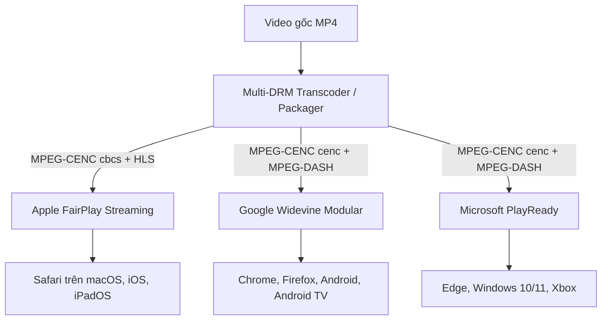
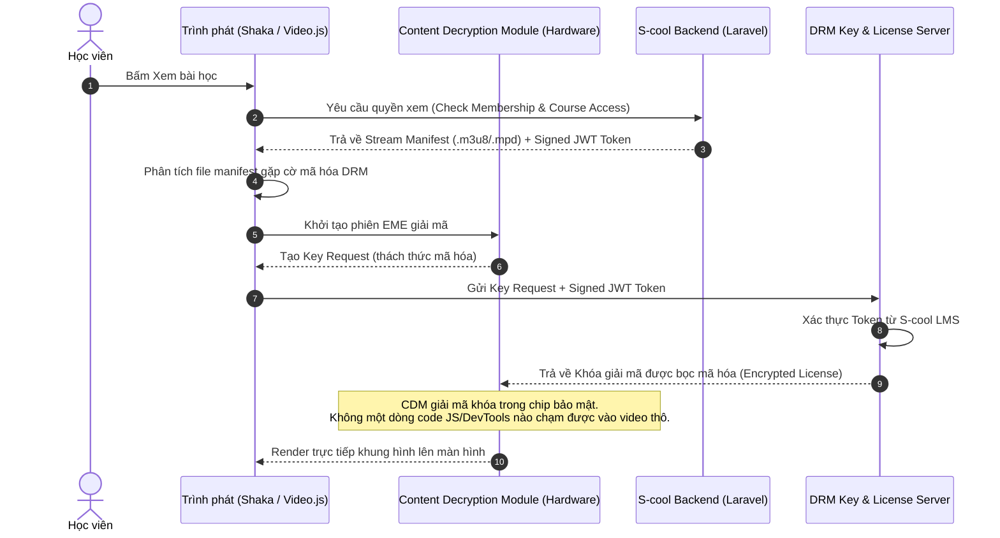
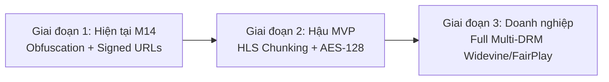

# EUR-85: Video Security and DRM Research Note
> **Báo cáo nghiên cứu chuyên sâu: Giải pháp Bảo vệ Video Khóa học & Đánh giá DRM**  
> **Dự án:** S-cool Platform (Milestone M14 — Owner-ready LMS)  
> **Mã issue:** [EUR-85](https://linear.app/eurusdevsec/issue/EUR-85/m14-video-security-and-drm-research-note)  
> **Người thực hiện:** Hà Đăng Khoa (Phụ trách An toàn thông tin & Nền tảng)  
> **Người review:** Lê Văn Hoàng (Kiến trúc sư hệ thống)  
> **Ngày lập:** 28/10/2026  
> **Trạng thái:** Hoàn tất nghiên cứu kỹ thuật (Implementation: Deferred)

---

## 1. Tóm tắt điều hành & Kết luận cốt lõi (Executive Summary)

Báo cáo này được thực hiện nhằm cung cấp câu trả lời kỹ thuật **rõ ràng, trung thực và dựa trên nguyên lý an ninh thông tin** cho Mentor và Product Owner về khả năng chống tải trộm/tải lậu video bài giảng trên hệ thống S-cool.

### Kết luận trực diện (Đáp ứng tiêu chí AC-01):
1. **Cơ chế 512-byte Masking hiện tại của S-cool KHÔNG PHẢI là DRM (Digital Rights Management).** Đây thực chất là kỹ thuật **Obfuscation (Làm rối mã / Che giấu nhị phân)** kết hợp cơ chế kiểm soát truy cập tầng ứng dụng (Access Control via Signed URLs & Anti-Sniffing Headers).
2. **Cơ chế hiện tại TUYỆT ĐỐI KHÔNG THỂ ngăn chặn một học viên hợp lệ (authorized viewer) trích xuất video gốc.** 
   - Nguyên nhân: Do video được giải mã (demask) trực tiếp bằng JavaScript trong bộ nhớ RAM của trình duyệt trước khi nạp vào thẻ HTML5 `<video>`, bất kỳ người dùng nào có kiến thức kỹ thuật cơ bản (F12 DevTools, Memory Dump, hoặc hook `URL.createObjectURL` / `MediaSource`) đều có thể trích xuất toàn bộ file MP4 gốc hoàn chỉnh trong vài giây.
3. **DRM thực thụ (Hardware-backed DRM)** là giải pháp duy nhất trên thế giới hiện nay có khả năng bảo vệ luồng giải mã xuống tận chip phần cứng (Trusted Execution Environment - TEE / Secure Video Path), chống trích xuất từ RAM và chống quay màn hình bằng phần mềm. Tuy nhiên, chi phí cố định, phí cấp phép bản quyền (licensing) và độ phức tạp hạ tầng của DRM là rào cản rất lớn đối với mô hình một website độc lập do chuyên gia tự vận hành.

---

## 2. So sánh chuyên sâu 3 cấp độ bảo vệ Video

Dưới đây là phân tích chi tiết 3 cấp độ bảo vệ từ cơ bản đến tiêu chuẩn điện ảnh (Hollywood-grade):

| Tiêu chí | Cấp độ 1: Signed URLs (URL có chữ ký) | Cấp độ 2: S-cool Obfuscation (512-byte Masking) | Cấp độ 3: Commercial Licensed DRM (Widevine / FairPlay / PlayReady) |
|---|---|---|---|
| **Cơ chế cốt lõi** | URL tạm thời có chữ ký HMAC, kiểm tra session/membership, hết hạn sau 15 phút. | XOR header 512 bytes (ftyp/moov box) + Giả mạo Content-Type `application/octet-stream` + Demask bằng JS trong RAM. | Mã hóa AES-128 (CTR/CBCS), chìa khóa giải mã nằm trong CDM phần cứng, cấp phép qua DRM License Server. |
| **Vị trí giải mã** | Không mã hóa payload video. | Trong bộ nhớ JavaScript (RAM của Tab trình duyệt). | Bên trong chip bảo mật phần cứng (TEE / Apple Secure Enclave / GPU Secure Path). |
| **Chống tải bằng IDM / Extension** | ⚠️ Kém (IDM tự bắt link download trực tiếp). | ✅ Rất tốt (IDM chỉ bắt được file `.bin` hỏng header, không xem được). | ✅ Tuyệt đối (Không downloader nào bắt được luồng giải mã). |
| **Chống tải bằng DevTools (F12) của học viên hợp lệ** | ❌ Không (Copy URL hoặc tải từ tab Network). | ❌ **Không ngăn được** (Học viên hook biến Blob hoặc lưu buffer sau vòng lặp XOR). | ✅ Tuyệt đối (Không lấy được khóa giải mã từ DevTools). |
| **Chống quay màn hình (Screen Recording)** | ❌ Không. | ❌ Không (Chỉ có Watermark trôi nổi để răn đe). | ✅ **Chặn được hầu hết phần mềm quay** (OBS, QuickTime, Discord stream sẽ chỉ thấy màn hình đen). |
| **Chống quay bằng Camera ngoài (Analog Hole)** | ❌ Không. | ❌ Không. | ❌ Không (Không công nghệ nào trên thế giới chặn được việc dùng điện thoại quay màn hình). |
| **Chi phí hạ tầng** | 0 VNĐ (Tính năng có sẵn của Laravel/Nginx). | 0 VNĐ (Tự viết bằng PHP + JavaScript). | **Cao** (Phí bản quyền SDK, phí mỗi lượt yêu cầu license, phí transcode HLS/DASH đa bitrate). |

---

## 3. Phân tích chi tiết cơ chế S-cool hiện tại & Điểm yếu chí mạng

### 3.1. Luồng hoạt động hiện tại trong mã nguồn
Hệ thống S-cool hiện đang sử dụng giải pháp tự xây dựng qua hai thành phần:
- **Backend:** [`SecureVideoStreamController.php`](file:///c:/Users/hadan/projects/scool/app/Http/Controllers/SecureVideoStreamController.php)
  - Sinh URL có chữ ký HMAC thời hạn 15 phút kèm theo `viewer_id`, `community_id`, `lesson_id`.
  - Chặn các User-Agent phổ biến của tool tải: `idm`, `curl`, `wget`, `yt-dlp`, `cococut`, `videodownloadhelper`...
  - Kiểm tra `Referer` và `Origin` cùng host; chặn truy cập trực tiếp từ thanh địa chỉ trình duyệt (`Sec-Fetch-Dest: document`).
  - Đổi header trả về thành `Content-Type: application/octet-stream` và `Content-Disposition: inline; filename="stream.bin"`.
  - Thực hiện XOR 512 bytes đầu tiên của file MP4 với chuỗi `maskKey` sinh từ HMAC-SHA256 của file path.
- **Frontend:** [`secure-video-player.blade.php`](file:///c:/Users/hadan/projects/scool/resources/views/components/secure-video-player.blade.php)
  - Chèn CSS ẩn các nút nổi của extension download.
  - Sử dụng `fetch()` tải toàn bộ file binary về một `ArrayBuffer`.
  - Chạy vòng lặp JavaScript đảo ngược phép toán XOR cho 512 bytes:
    ```javascript
    const view = new Uint8Array(buffer);
    for (let i = 0; i < bytesToDemask; i++) {
        view[i] ^= maskKey.charCodeAt(i % maskKey.length);
    }
    const blob = new Blob([view], { type: 'video/mp4' });
    this.blobUrl = URL.createObjectURL(blob);
    ```
  - Chạy `setInterval` làm trôi địa chỉ email học viên (Watermark động) trên bề mặt video.

### 3.2. Vì sao cơ chế này không thể ngăn được học viên hợp lệ trích xuất?
1. **Khóa giải mã nằm ngay trên Client:** Chuỗi `maskKey` và thuật toán XOR nằm hoàn toàn trong mã nguồn JavaScript gửi tới trình duyệt.
2. **Toàn bộ video giải mã nằm trong RAM:** Đối tượng `blob` được khởi tạo thành công với MIME chuẩn `video/mp4`. Một người dùng chỉ cần:
   - Gõ 1 dòng lệnh vào Console F12:
     ```javascript
     const a = document.createElement('a');
     a.href = Alpine.$data(document.querySelector('[x-data]')).blobUrl;
     a.download = 'khoa-hoc-goc.mp4';
     a.click();
     ```
   - Ngay lập tức trình duyệt sẽ tải xuống file video MP4 gốc sắc nét 100%.
3. **Bộ nhớ bị quá tải khi video dài:** Vì cơ chế hiện tại dùng `fetch()` tải toàn bộ file vào `ArrayBuffer` trong RAM thay vì chia đoạn (chunking), nếu bài giảng dài 1-2 tiếng (nặng 1GB - 2GB), trình duyệt trên điện thoại hoặc máy tính cấu hình yếu sẽ bị crash tab (Out of Memory).

---

## 4. Kiến trúc DRM tiêu chuẩn công nghiệp (Commercial DRM Standards)

### 4.1. Bộ ba hệ thống DRM độc quyền (The "Big Three")
Không có một hệ sinh thái DRM duy nhất nào hoạt động trên mọi trình duyệt. Tiêu chuẩn quốc tế bắt buộc phải kết hợp cả 3 nhà cung cấp:



1. **Google Widevine:**
   - **Widevine L1 (Phần cứng):** Khóa giải mã và luồng video được xử lý hoàn toàn trong TEE (Trusted Execution Environment). Chống quay màn hình tuyệt đối (màn hình đen khi ghi hình).
   - **Widevine L3 (Phần mềm):** Dành cho các thiết bị không có chip TEE hoặc trình duyệt máy tính thông thường (Chrome trên Windows/Linux). Có thể bị tấn công bằng kỹ thuật dump CDM memory chuyên dụng.
2. **Apple FairPlay Streaming (FPS):**
   - Độc quyền cho các thiết bị Apple. Khóa được giải mã thông qua Apple Secure Enclave và hệ thống AVPlayer native.
3. **Microsoft PlayReady:**
   - Tích hợp sâu vào nhân Windows và trình duyệt Microsoft Edge (PlayReady SL3000 / SL2000).

### 4.2. Luồng bảo vệ video chuẩn với W3C Encrypted Media Extensions (EME)


---

## 5. Đánh giá các nhà cung cấp giải pháp (Provider Options) & Bài toán chi phí

Đối với mô hình của S-cool — **mỗi chuyên gia sở hữu một website độc lập (Independent Expert Deployment)** — việc tự xây dựng hạ tầng License Server (KMS) và Transcoder là bất khả thi vì chi phí vận hành quá lớn. Các lựa chọn dịch vụ Cloud video khả dĩ gồm:

### 5.1. Bảng so sánh nhà cung cấp

| Nhà cung cấp | Hỗ trợ DRM thực thụ? | Chi phí ước tính | Điểm mạnh | Hạn chế đối với mô hình S-cool |
|---|---|---|---|---|
| **Mux Video (Mux DRM)** *(Tham chiếu: [Mux DRM Guide](https://www.mux.com/docs/guides/protect-videos-with-drm))* | **Có (Full Multi-DRM)**: Widevine + FairPlay + PlayReady | • Transcode: ~$0.005 / phút<br>• Lưu trữ: ~$0.003 / phút/tháng<br>• Phát: ~$0.0013 / phút xem<br>• DRM Licensing: ~$0.02 - $0.05 / license | • API chuẩn hiện đại, cực kỳ dễ tích hợp với Laravel.<br>• Quản lý toàn diện cả 3 hệ DRM không cần giấy phép riêng với Apple/Google. | Chi phí theo usage (Pay-as-you-go). Nếu học viên xem nhiều hoặc khóa học rất nhiều video, chi phí hàng tháng sẽ tăng theo cấp số nhân. |
| **Cloudflare Stream** | **Không có DRM chuẩn** ở gói thường. Chỉ có HLS AES-128 Encryption & Signed URLs. Muốn Widevine/FairPlay phải lên gói Enterprise ($$$$). | • $5 / 1.000 phút lưu trữ.<br>• $1 / 1.000 phút xem.<br>(Không giới hạn băng thông). | • Chi phí cực kỳ rẻ và ổn định.<br>• Global CDN nhanh nhất thị trường. | Không chặn được phần mềm quay màn hình; vẫn có thể bị trích xuất bởi công cụ chuyên dụng nếu lộ key HLS. |
| **Bunny.net (Bunny Stream)** | **Không có DRM**. Sử dụng MediaCage (HLS token authentication & Dynamic Watermarking). | • Lưu trữ: $0.01 / GB.<br>• Băng thông: $0.005 - $0.01 / GB.<br>(Rất rẻ). | • Giá rẻ bậc nhất hiện nay.<br>• Giao diện quản lý trực quan, dễ nhúng iframe hoặc player. | Không phải là DRM chuẩn Hollywood. Không bảo vệ được cấp độ phần cứng. |
| **AWS MediaConvert + EZDRM** | **Có (Full Multi-DRM)**. | • AWS MediaConvert: ~$0.015 / phút.<br>• S3 + CloudFront: tính theo GB.<br>• EZDRM License: tối thiểu $199 - $399/tháng cố định. | • Tiêu chuẩn của các tập đoàn truyền thông lớn. | Kiến trúc cực kỳ phức tạp (cần cấu hình SPEKE, IAM, KMS, Lambda); chi phí cố định tối thiểu quá cao cho một website riêng lẻ. |

### 5.2. Bài toán chi phí cho 1 Website Chuyên gia (Case Study: 1 Chuyên gia, 5 Khóa học, 50 Giờ Video, 500 Học viên)
Giả định kịch bản thực tế của một website S-cool:
- Tổng dung lượng video: 50 giờ = 3.000 phút.
- Mỗi học viên xem trung bình 20 giờ video/tháng: 500 học viên × 1.200 phút = 600.000 phút xem/tháng.

**Tính toán chi phí hàng tháng:**
1. **Nếu dùng giải pháp S-cool hiện tại (Tự host trên CloudPanel / VPS):**
   - Chi phí thêm: **0 VNĐ** (chỉ tốn tiền ổ cứng VPS ~$10 - $20/tháng).
   - Rủi ro: Có thể bị học viên trích xuất video hoặc chia sẻ tài khoản.
2. **Nếu dùng Bunny Stream / Cloudflare Stream (HLS Token Auth):**
   - Lưu trữ 50 giờ (~50GB): ~$2.5 / tháng.
   - Băng thông phát video: ~$20 - $35 / tháng.
   - Tổng cộng: **~$30 - $40 / tháng (~800.000 - 1.000.000 VNĐ/tháng)**.
3. **Nếu dùng Full Multi-DRM (Mux DRM):**
   - Lưu trữ 3.000 phút: $9 / tháng.
   - Băng thông 600.000 phút xem: $780 / tháng.
   - Phí DRM License requests: ~$50 - $100 / tháng.
   - Tổng cộng: **~$850 - $900 / tháng (~21.000.000 - 23.000.000 VNĐ/tháng)**.

=> **Nhận định kinh tế:** Chi phí Full DRM bản quyền là **quá đắt đỏ** đối với đại đa số chuyên gia bán khóa học đơn lẻ, trừ các tổ chức giáo dục có doanh thu hàng tỷ đồng mỗi tháng hoặc các hãng phim có hợp đồng bản quyền bắt buộc phải tuân thủ chuẩn MPAA.

---

## 6. Khuyến nghị lộ trình thực tế cho S-cool (Đáp ứng tiêu chí AC-02)

Dựa trên sự cân bằng giữa **mức độ an toàn**, **trải nghiệm người dùng** và **hiệu quả kinh tế**, nhóm nghiên cứu khuyến nghị lộ trình 3 giai đoạn như sau:



### Giai đoạn 1 (Giai đoạn hiện tại — M14 Baseline):
* **Hành động:** Giữ nguyên cơ chế hiện tại nhưng **chuẩn hóa lại cách truyền thông** với khách hàng và mentor:
  - *Không quảng cáo cơ chế hiện tại là DRM.* Gọi đúng tên là **"Hệ thống phân luồng bảo mật chống công cụ tải tự động (Anti-Sniffing & Stream Obfuscation)"**.
  - Tối ưu hóa bộ phát: Bổ sung Watermark động hiển thị email và số điện thoại học viên dạng bán trong suốt chạy ngẫu nhiên trên khung hình để triệt tiêu động cơ quay lén chia sẻ ra ngoài (Social Stigmatization).

### Giai đoạn 2 (Giai đoạn chuyển tiếp — Khuyến nghị triển khai sau M14):
* **Giải pháp:** Chuyển từ streaming MP4 nguyên khối sang **HLS (HTTP Live Streaming) có mã hóa phân đoạn AES-128**.
* **Ưu điểm:**
  - Video được cắt thành hàng nghìn file nhỏ `.ts` dài 3–6 giây và mã hóa bằng AES-128.
  - Trình duyệt chỉ giải mã từng đoạn ngắn rồi xả RAM ngay lập tức, khắc phục hoàn toàn lỗi tràn RAM (Out of Memory) trên thiết bị di động.
  - Chống tải lại đến 98% đối với người dùng phổ thông.
  - Tích hợp được qua **Bunny Stream** hoặc **Cloudflare Stream** với chi phí cực kỳ rẻ (~30$/tháng/website).

### Giai đoạn 3 (Giai đoạn Nâng cao — Chỉ khi có yêu cầu đặc thù và ngân sách lớn):
* **Giải pháp:** Tích hợp **Mux DRM** hoặc **AWS MediaConvert + Speke DRM Server**.
* **Điều kiện tiên quyết:** Chuyên gia có ngân sách sẵn sàng chi trả từ $500 - $1.000/tháng cho chi phí bảo quyền video.

---

## 7. Các câu hỏi mở cần Mentor & Product Owner quyết định (Open Questions)

Trước khi quyết định có đầu tư triển khai DRM thực thụ hay không ở các mốc sau, nhóm kiến trúc đề xuất Mentor và Product Owner xem xét 4 câu hỏi:

1. **Khẩu vị rủi ro bản quyền của Chuyên gia là gì?**
   - Mục tiêu là ngăn chặn 95% học viên thông thường và các công cụ tải lậu thông dụng (IDM, extension trình duyệt), hay bắt buộc phải chặn cả 1% người dùng am hiểu công nghệ và hacker chuyên nghiệp?
2. **Ai sẽ là người chi trả chi phí bản quyền video hàng tháng?**
   - Nếu triển khai Multi-DRM (chi phí từ 10 - 20 triệu VNĐ/tháng), chi phí này sẽ do Chuyên gia tự trả trực tiếp cho bên thứ 3 (Mux/AWS), hay tính vào gói thuê nền tảng S-cool?
3. **Chấp nhận sự đánh đổi về tính độc lập của máy chủ?**
   - Nếu áp dụng DRM, website của chuyên gia bắt buộc phải phụ thuộc vào các dịch vụ Cloud bên thứ 3 của Mỹ (Mux/AWS/Cloudflare), không thể chạy hoàn toàn độc lập (Self-hosted 100%) trên VPS giá rẻ như kiến trúc hiện tại.
4. **Vấn đề bản quyền tài khoản Apple Developer & Google Widevine:**
   - Để cấp phát chứng chỉ FairPlay, chuyên gia hoặc S-cool phải sở hữu tài khoản Apple Developer Organization và ký thỏa thuận bản quyền trực tiếp với Apple. Đội ngũ đã sẵn sàng cho quy trình pháp lý này chưa?

---

## 8. Danh mục tài liệu tham khảo chính thức (Primary References)

1. **Mux DRM Guide:** *Protect Videos with DRM (Widevine and FairPlay)* — [https://www.mux.com/docs/guides/protect-videos-with-drm](https://www.mux.com/docs/guides/protect-videos-with-drm)
2. **W3C Recommendation:** *Encrypted Media Extensions (EME)* — [https://www.w3.org/TR/encrypted-media/](https://www.w3.org/TR/encrypted-media/)
3. **ISO/IEC 23001-7:** *Information technology — MPEG systems technologies — Part 7: Common encryption in ISO base media file format files (CENC)*.
4. **Apple Developer Documentation:** *FairPlay Streaming (FPS) Overview* — [https://developer.apple.com/streaming/fps/](https://developer.apple.com/streaming/fps/)
5. **Google Widevine DRM Architecture:** *Widevine Modular DRM Architecture Overview* — [https://www.widevine.com/solutions](https://www.widevine.com/solutions)
6. **Cloudflare Stream Docs:** *Secure your videos with signed tokens and watermarking* — [https://developers.cloudflare.com/stream/viewing-videos/securing-your-stream/](https://developers.cloudflare.com/stream/viewing-videos/securing-your-stream/)
