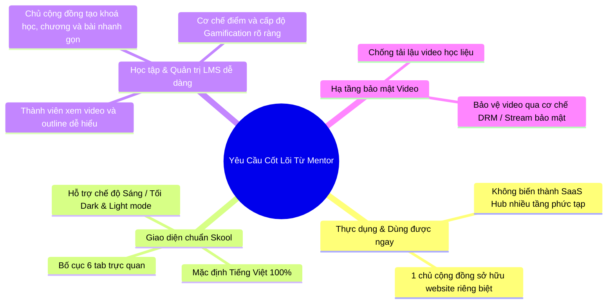

# Phân Tích Yêu Cầu Mentor & Đối Chiếu Tham Chiếu Skool (S-cool)

> **Tài liệu phân tích kỹ thuật & định hướng thực thi**  
> **Mục tiêu:** Diễn giải chi tiết, rõ ràng, dễ hiểu cho toàn bộ thành viên trong nhóm và các bên liên quan về yêu cầu của Mentor, giải phẫu website tham chiếu [skool.phung.vn](https://skool.phung.vn), đối chiếu hiện trạng dự án **S-cool**, và xây dựng giải pháp thực thi chuẩn xác mà không phá vỡ kiến trúc sẵn có hay gây xung đột CI.

---

## 1. Tóm Tắt Nhanh: Mentor Thực Sự Muốn Gì?

Qua tin nhắn trao đổi, Mentor đã đưa ra 4 thông điệp cốt lõi định hình lại trải nghiệm sản phẩm:



### Diễn giải trực quan:
1. **"Còn anh chỉ cần cái dùng được và đơn giản":**  
   Mentor muốn một sản phẩm hoàn thiện, thực chiến, không lý thuyết suông. Tránh việc xây dựng các tính năng trừu tượng khó dùng hoặc phân nhánh quá nhiều mà tập trung vào các tính năng người dùng thực sự chạm vào hàng ngày.
2. **"Ở đây không tập trung vào 1 hub SaaS, mà có thể là 1 chủ cộng đồng là sở hữu cả web luôn":**  
   Thay vì bắt người dùng phải qua màn hình khám phá nhiều cộng đồng, danh bạ SaaS, khi một thành viên truy cập website, trải nghiệm phải hướng trọn vẹn vào **Cộng đồng học tập duy nhất** của chính chủ sở hữu đó (Single-Community Workspace).
3. **"Giao diện mặc định là Tiếng Việt, càng giống Skool càng tốt":**  
   Giao diện thân thiện tối đa với người dùng Việt Nam. Bố cục học hỏi từ mô hình Skool: tinh gọn, trực quan, có chế độ chuyển nền **Sáng / Tối (Dark / Light Mode)**.
4. **"Vận hành cộng đồng, tạo khoá học, cơ chế điểm, bảo mật video DRM":**  
   - Tạo khoá học (Course) -> Tạo chương (Section) -> Thêm bài học (Lesson) một cách trực quan.
   - Thành viên học có video player trung tâm, checklist hoàn thành bài học, thanh tiến độ %.
   - Thành viên thảo luận, tương tác được tích lũy điểm kinh nghiệm (XP), lên cấp (Level) và xếp hạng.
   - Video bài giảng phải được bảo vệ, chống công cụ tải lậu (IDM, extension trình duyệt).

---

## 2. Giải Phẫu Thực Tế Website Tham Chiếu (`https://skool.phung.vn`)

Dựa trên khảo sát thực tế qua tài khoản Quản trị viên (`phungnm@eti.vn`) và Thành viên (`user@eti.vn`), hệ thống tham chiếu có các thành phần cấu tạo như sau:

### 2.1. Kiến trúc Header & Điều hướng toàn cục
- **Thanh Header cố định:**
  - Logo và Tên cộng đồng (Digital HUB).
  - Khung tìm kiếm nội dung (bài viết, khóa học, thành viên).
  - Phím tiện ích: Tin nhắn, Thông báo.
  - **Phím chuyển đổi Giao diện Sáng / Tối:** Hiển thị trực tiếp trên header (`Đang: Tối` hoặc `Đang: Sáng`), cho phép chuyển đổi tức thì.
  - Avatar & Menu tài khoản (Hồ sơ, Công cụ quản lý, Cài đặt, Đăng xuất).

### 2.2. Hệ thống 6 Tab cốt lõi chuẩn Skool
| Tab | Vai trò đối với Thành viên | Thành phần hiển thị chính |
|---|---|---|
| **Cộng Đồng** (Feed) | Thảo luận, tương tác | - Khung đăng bài viết (kèm chọn danh mục: Thông báo, Thảo luận chung, Hỏi đáp)<br>- Danh sách bài viết, nút Like, Bình luận<br>- **Sidebar bên phải:** Cấp độ cá nhân (Level, XP, thanh tiến độ % lên cấp tiếp theo) và Bảng Top 3 đóng góp trong 30 ngày |
| **Lớp Học** (Classroom) | Khoá học & Học tập | - Thư viện các khoá học dạng thẻ (Thumbnail, Tên khoá học, Số bài học, Tiến độ % hoàn thành)<br>- Khi bấm vào khoá học: Giao diện học tập 2 cột (Cột lớn: Video player + Tabs Tổng quan/Tài liệu/Thảo luận; Cột nhỏ: Danh sách các Chương và Bài học dạng Accordion) |
| **Lịch** (Calendar) | Sự kiện cộng đồng | Lịch các buổi workshop, coaching, sự kiện trực tuyến |
| **Thành Viên** (Members) | Kết nối người học | Danh bạ thành viên, bộ lọc theo chức vụ (Admin, Moderator, Thành viên), cấp độ XP |
| **Bảng Xếp Hạng** (Leaderboard) | Động lực tương tác | - Hệ thống cấp bậc (Level 1..6 và quyền lợi tương ứng)<br>- Bảng xếp hạng thi đua theo chu kỳ: 7 ngày qua, 30 ngày qua, Tất cả |
| **Giới Thiệu** (About) | Giới thiệu cộng đồng | Thông tin mô tả cộng đồng, nội quy, giới thiệu người sáng lập |

### 2.3. Khu vực Quản lý của Chủ cộng đồng (LMS Admin)
- Khi quản trị viên truy cập **Công cụ quản lý -> Đào tạo (LMS)**:
  - Danh sách khoá học: Trạng thái kích hoạt, số bài học, số học viên.
  - Nút **Tạo khoá học mới** & **Chỉnh sửa nội dung**:
    - Quản lý cấu trúc theo dạng cây: **Khoá học (Course) -> Chương (Section) -> Bài học (Lesson)**.
    - Soạn thảo tiêu đề, đính kèm link video, mô tả bài học.

---

## 3. Đối Chiếu Với Dự Án Hiện Tại (S-cool): Những Gì ĐÃ CÓ

Rất nhiều tính năng cốt lõi mà Mentor mong muốn **thực chất đã được xây dựng sẵn trong S-cool ở tầng Backend và Cơ sở dữ liệu**. Điều này có nghĩa là chúng ta **KHÔNG CẦN đập đi xây lại hay thay đổi cấu trúc dữ liệu**:

```
+------------------------------------------------------------------------------------+
|                                HIỆN TRẠNG S-COOL                                   |
+-----------------------------------+------------------------------------------------+
| Yêu cầu của Mentor                | Mã nguồn hiện có trong S-cool                  |
+-----------------------------------+------------------------------------------------+
| 1. Bố cục 6 tab chuẩn Skool       | Đã có sẵn trong component                      |
|                                   | resources/views/components/community-workspace |
+-----------------------------------+------------------------------------------------+
| 2. Cơ chế Điểm & Cấp độ           | Đã có Model PointContribution, Service         |
|    (Gamification)                 | CommunityContributionService, Controller       |
|                                   | CommunityLeaderboardController (Level 1..5)    |
+-----------------------------------+------------------------------------------------+
| 3. Quản lý khoá học & bài học     | Đã có đầy đủ Models: Course, CourseSection,    |
|    (LMS)                          | Lesson, LessonProgress và các Controllers      |
+-----------------------------------+------------------------------------------------+
| 4. Bảo mật video chống tải        | Đã có SecureVideoStreamController với cơ chế   |
|    (Anti-download / DRM)          | XOR byte-masking và token tạm thời ký số       |
+-----------------------------------+------------------------------------------------+
| 5. Ngôn ngữ Tiếng Việt            | Đã dùng helper `__('...')`, chuẩn bị file      |
|                                   | lang/vi.json để kích hoạt toàn diện            |
+-----------------------------------+------------------------------------------------+
| 6. Chuyển đổi Sáng / Tối          | Tailwind CSS 4 & Alpine.js hỗ trợ class .dark  |
+-----------------------------------+------------------------------------------------+
```

---

## 4. Giải Pháp Chi Tiết Từng Yêu Cầu (Không Gây Xung Đột Mã Nguồn)

### 4.1. Giải pháp Chuyển đổi Sáng / Tối (Dark / Light Mode)
- **Nguyên lý:**
  - Tailwind CSS cung cấp cơ chế `@variant dark (&:where(.dark, .dark *));` hoặc `darkMode: 'class'`. Khi thẻ `<html class="dark">` có class `dark`, toàn bộ các class `dark:...` sẽ được kích hoạt.
  - Trạng thái theme được lưu ở `localStorage.getItem('theme')` để ghi nhớ lựa chọn của người dùng khi chuyển trang.
- **Cách làm cụ thể:**
  1. Thêm một đoạn script inline siêu ngắn trong thẻ `<head>` của `resources/views/layouts/app.blade.php`:
     ```javascript
     if (localStorage.theme === 'dark' || (!('theme' in localStorage) && window.matchMedia('(prefers-color-scheme: dark)').matches)) {
         document.documentElement.classList.add('dark');
     } else {
         document.documentElement.classList.remove('dark');
     }
     ```
  2. Bổ sung nút chuyển Sáng / Tối tại `resources/views/layouts/navigation.blade.php` sử dụng Alpine.js:
     ```html
     <button type="button" @click="
         $el.closest('html').classList.toggle('dark');
         localStorage.theme = $el.closest('html').classList.contains('dark') ? 'dark' : 'light';
     " class="p-2 rounded-xl text-slate-500 hover:text-slate-800 dark:text-slate-400 dark:hover:text-slate-100">
         <!-- Icon Sun / Moon -->
     </button>
     ```
  3. Bổ sung các biến màu tối trong `tailwind.config.js` hoặc file CSS tương ứng với semantic tokens:
     - Nền tối: `dark:bg-[#09090B]` hoặc `dark:bg-slate-950`
     - Khối nội dung tối (Surface): `dark:bg-slate-900`
     - Viền tối: `dark:border-slate-800`
     - Chữ sáng: `dark:text-slate-100`, `dark:text-slate-400`

### 4.2. Giải pháp Mặc định Tiếng Việt Toàn Diện
- **Nguyên lý:**
  - Không sửa trực tiếp (hardcode) chuỗi tiếng Việt vào mã nguồn Blade. Việc hardcode vừa làm hỏng tính quốc tế hóa, vừa có nguy cơ làm gãy các bài test PHPUnit đang assert các cụm từ tiếng Anh.
  - Sử dụng cơ chế từ điển bản địa hóa chuẩn của Laravel: `lang/vi.json`.
- **Cách làm cụ thể:**
  1. Tạo file `lang/vi.json` chứa bản dịch của toàn bộ các key hiện có trong view:
     ```json
     {
       "Community Feed": "Cộng Đồng",
       "Classroom": "Lớp Học",
       "Events": "Lịch",
       "Members": "Thành Viên",
       "Leaderboard": "Bảng Xếp Hạng",
       "About": "Giới Thiệu",
       "Create Post": "Đăng Bài Viết",
       "Completed": "Hoàn Thành",
       "Level": "Cấp Độ"
     }
     ```
  2. Đặt cấu hình mặc định trong `.env`:
     ```env
     APP_LOCALE=vi
     APP_FALLBACK_LOCALE=en
     ```
  3. Đảm bảo cấu hình trong `phpunit.xml` luôn giữ:
     ```xml
     <env name="APP_LOCALE" value="en"/>
     ```
     -> **Kết quả:** Trên trình duyệt người dùng nhìn thấy 100% Tiếng Việt, nhưng khi chạy CI test tự động, hệ thống vẫn giữ nguyên ngữ cảnh `en` giúp toàn bộ các bài kiểm thử cũ PASS 100%.

### 4.3. Giải pháp Trải nghiệm Single-Community (Chủ sở hữu web)
- **Mục tiêu:** Không để người dùng bị lạc vào SaaS Hub nhiều tầng.
- **Cách xử lý luồng:**
  - Trong Controller xử lý trang chủ hoặc dashboard (`DashboardController`), kiểm tra:
    - Nếu hệ thống có cộng đồng active chính (hoặc người dùng đã có tư cách thành viên ở một cộng đồng), tự động chuyển hướng (302 redirect) vào thẳng không gian làm việc:
      `route('communities.posts.index', $defaultCommunity)`
  - Điều này tạo cảm giác người dùng đang vào một trang web chuyên biệt của riêng cộng đồng đó (đúng như kỳ vọng của mentor), trong khi kiến trúc cơ sở dữ liệu bên dưới vẫn giữ nguyên tính độc lập đa cộng đồng (Multi-tenancy).

### 4.4. Giải pháp Bảo mật Video (DRM & Anti-download)
- **Vấn đề thực tế:** Video bài giảng dạng tĩnh (`.mp4`) rất dễ bị các extension hoặc IDM bắt link tải về.
- **Giải pháp sẵn có trong S-cool cần hoàn thiện:**
  1. **Token hóa đường dẫn (Signed URL):** Link video chỉ có hiệu lực trong 15 phút và gắn chặt với ID của tài khoản đang đăng nhập (`viewer`).
  2. **XOR Byte-masking (DRM mức ứng dụng):**
     - [SecureVideoStreamController](file:///d:/ThucTapDN/S-cool/app/Http/Controllers/SecureVideoStreamController.php) xáo trộn (mask) 512 bytes đầu tiên của file MP4 trước khi stream.
     - Khi tải về trực tiếp, file sẽ bị lỗi định dạng (hỏng header container `ftyp`/`moov`), không thể phát bằng bất kỳ phần mềm nào (VLC, Windows Media Player, v.v.).
     - Trình phát web chuyên dụng (`<x-secure-video-player>`) sẽ nhận byte stream, đảo ngược mặt nạ (demask) trong RAM trình duyệt thông qua Javascript Blob để phát mượt mà.
  3. **Khắc phục lỗi phát video:**
     - Tối ưu luồng stream hỗ trợ chuẩn HTTP 206 Partial Content (Range Requests) để tua video mượt mà.
     - Cung cấp cơ chế fallback hỗ trợ link video nhúng (YouTube Unlisted, Vimeo, Loom) khi creator muốn sử dụng nguồn ngoài.

---

## 5. Chiến Lược Thực Hiện & Phòng Ngừa Sự Cố CI (Tránh Drain Token)

Để đảm bảo quá trình thực hiện suôn sẻ, không phát sinh lỗi vòng lặp trên CI:

| Hạng mục kiểm tra | Nguy cơ tiềm ẩn | Biện pháp phòng ngừa chuẩn xác |
|---|---|---|
| **PHP Pint** | Lỗi format code (thừa khoảng trắng, thụt lề sai) | Luôn chạy `composer run pint:test` trước khi bàn giao; tự động sửa bằng `composer run pint`. |
| **PHPStan (Static Analysis)** | Lỗi type hint, gọi method không tồn tại | Chạy `vendor/bin/phpstan analyse --configuration=phpstan.neon --memory-limit=512M`. |
| **PHPUnit Application Test** | Assert text thất bại do đổi ngôn ngữ | Giữ `APP_LOCALE=en` trong `phpunit.xml`. Chạy test trên môi trường test riêng biệt `scool_test`. |
| **Semgrep Security** | Vi phạm quy tắc bảo mật (SQL Injection, XSS) | Không dùng raw HTML không qua escape; tuân thủ quy tắc sanitize biến trong Blade. |
| **Vite Frontend Build** | Lỗi CSS selector hoặc thiếu asset build | Chạy `npm run build` để kiểm tra tạo file `public/build/manifest.json` thành công. |

---

## 6. Lộ Trình Triển Khai Đề Xuất (Theo thứ tự ưu tiên)

1. **Giai đoạn 1 (Ngôn ngữ & Theme):**
   - Tạo file `lang/vi.json` cho giao diện chính.
   - Thêm nút switch Dark/Light mode trên thanh điều hướng với Alpine.js và cấu hình Tailwind.
2. **Giai đoạn 2 (Trải nghiệm Lớp học & Bảo mật Video):**
   - Tối ưu giao diện học tập: Video player trung tâm + Outline bài học dạng danh sách rút gọn.
   - Kiểm tra và ổn định luồng phát video bảo mật của `SecureVideoStreamController`.
3. **Giai đoạn 3 (Đồng bộ Bảng xếp hạng & Cấp độ):**
   - Đảm bảo widget hiển thị Cấp độ cá nhân (Level/XP) và Top 3 BXH tại sidebar hoạt động chuẩn xác với dữ liệu thực tế.
4. **Giai đoạn 4 (Kiểm thử toàn diện & Đóng gói):**
   - Chạy full suite CI (Pint, PHPStan, PHPUnit, Build) đảm bảo mọi tiêu chuẩn chất lượng đều đạt 100%.
