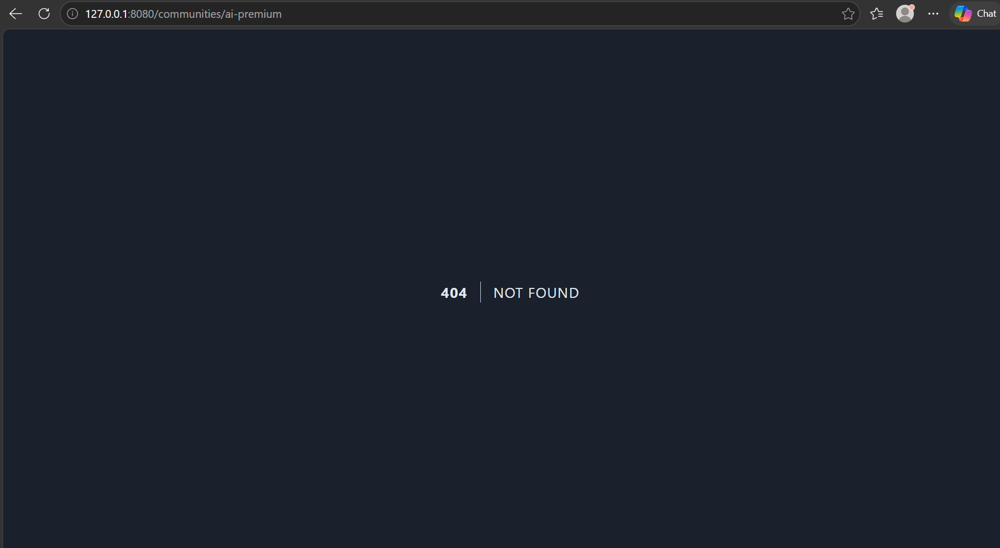
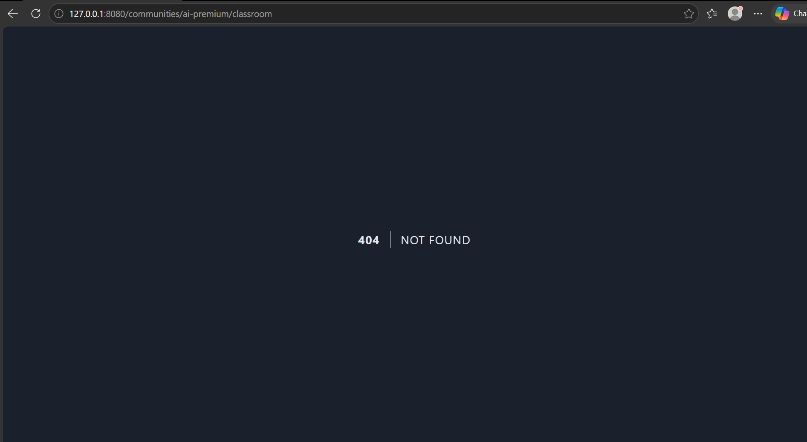
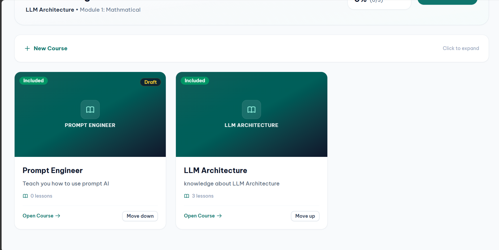
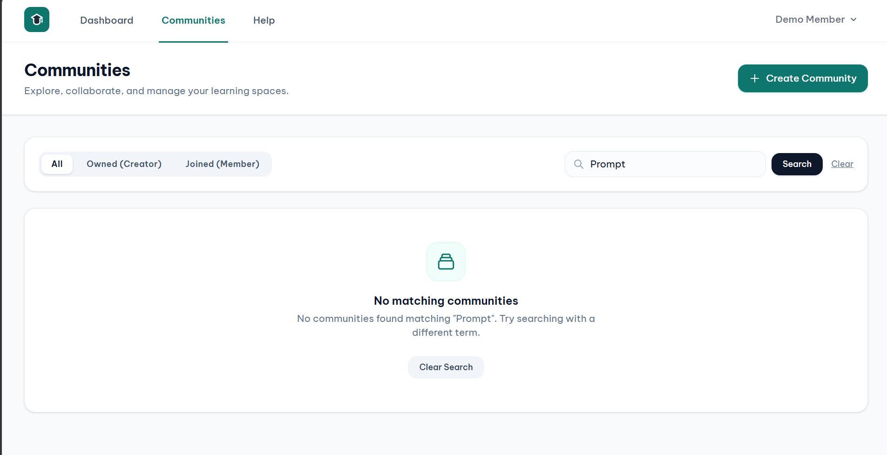
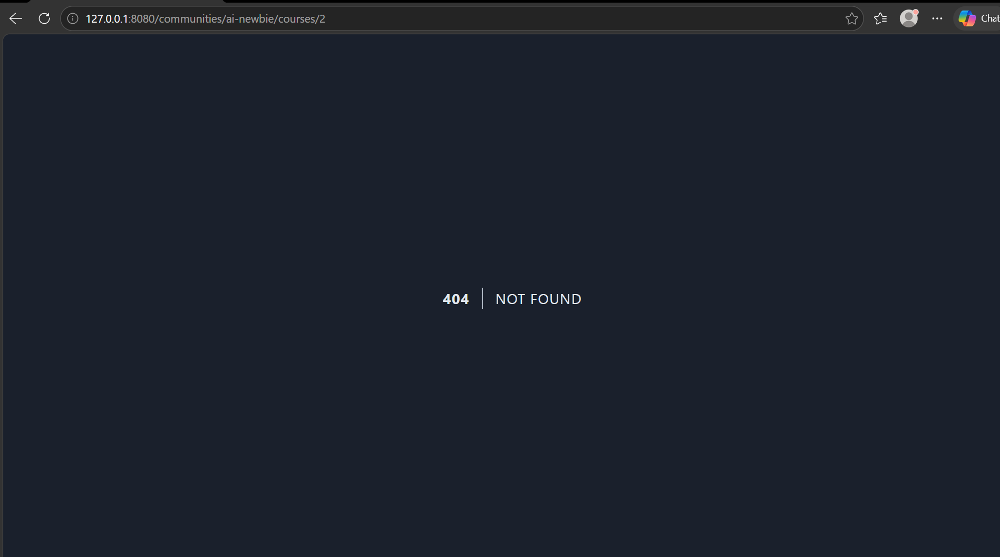
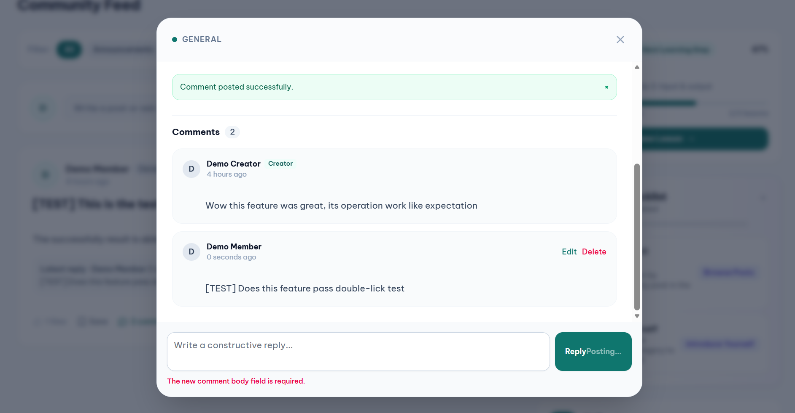
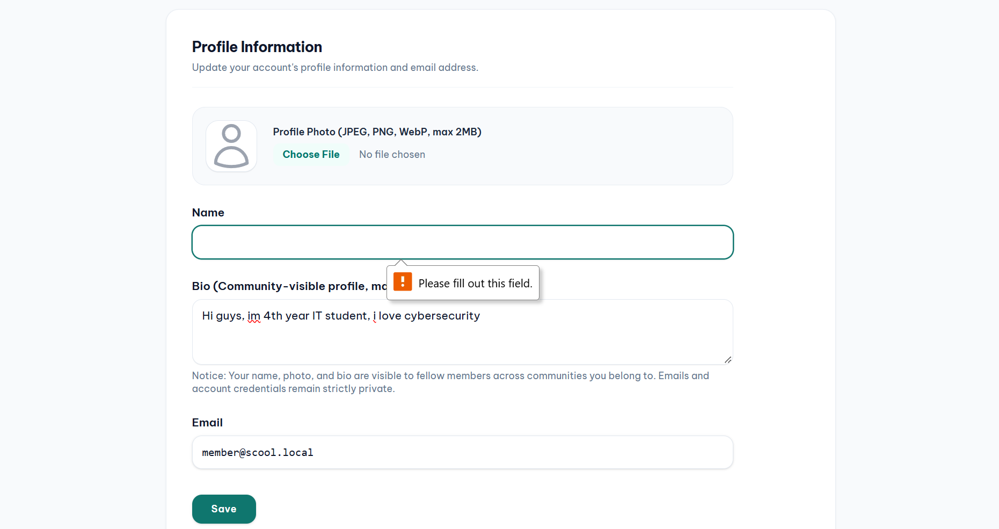
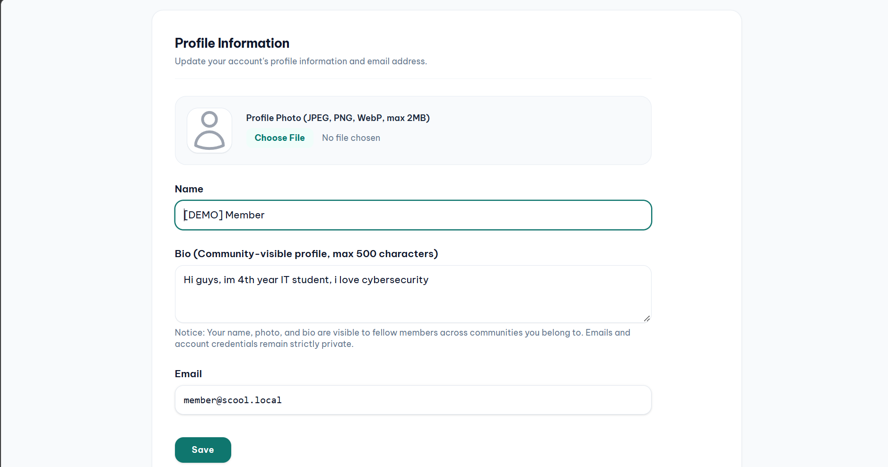

> Historical screenshot gallery. Interpret the limited observations using [the corrected boundary report](EUR-58-summary.md); passing observations are not previously fixed defects.

# Test cô lập giữa các Tenant
## Truy cập chéo tài nguyên qua URL bị chặn

# Kiểm tra nội dung nháp & Chưa được cấp quyền
## Xem khóa học chưa được xuất bản
### Creator tạo khóa học `DRAFT`

### Community discovery screenshot; tenant draft-content search is N/T

### Member thử truy cập `DRAFT` Course qua URL

# Chống lặp thao tác & Xử lý bất đồng bộ
## Kịch bản Click - Double click

# Khôi phục lỗi & trạng thái trình duyệt
## Native required-field validation retains the existing DOM input; server validation is N/T

## Kiểm tra không bị gửi lại dữ liệu đã submit

