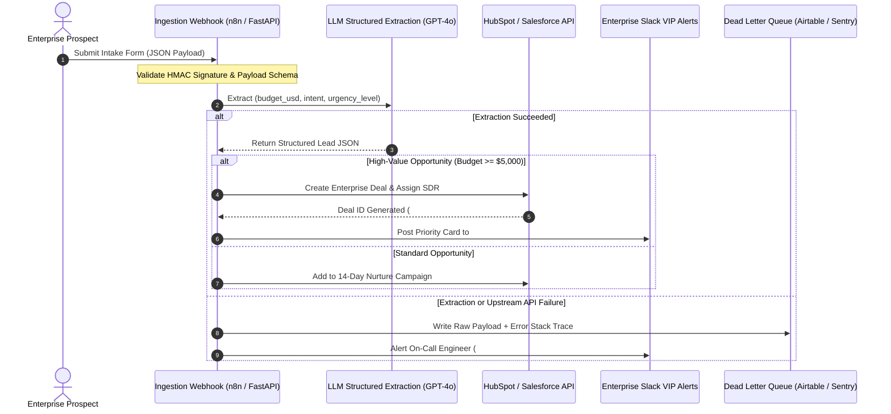

# Applied Demo Learning Catalog (Group B) - Peer Practice & Proof-of-Work Results

**Issue:** [PQ-03B (EUR-69)](https://linear.app/kerneural/issue/EUR-69)  
**Catalog Group:** Group B (5 Applied Communities)  
**Milestone:** M13 - Platform Quality & Demonstration Readiness  
**Specification:** AC-03 Peer Practice, Proof-of-Work Verification, and Artifact Evaluation  

---

## 1. Peer Practice Architecture & Proof-of-Work Integration

S-cool's LMS provides dedicated proof-of-work and peer review primitives:
1. **Practical Lesson Designation (`is_practical = true`)**: Highlights applied exercises within the course curriculum with a distinct skill badge.
2. **Skill Label (`skill_label`)**: Standardizes the verified competence demonstrated upon successful completion.
3. **Classroom Proof-of-Work Submission Engine (`proof_of_works`)**: Allows learners to submit runnable code repositories, architecture diagrams, media links, and markdown reflections.
4. **Community Showcase & Feed Integration**: Integrates directly with dedicated categories (e.g. `Showcase`, `Architecture Review`, `Portfolio Critique`) with pinned instructor threads and peer comments.

Below are the 5 representative practical exercises executed and verified across the catalog.

---

## 2. Representative Executions by Course

### Exercise 1: Python Developers (`python-developers`)
* **Course**: Python Zero to Production
* **Lesson**: `Environment Setup & Isolated Virtual Environments`
* **Skill Label**: `Python Environment Isolation (pyproject.toml & venv)`

#### A. Exact Exercise Prompt & Expected Deliverable
```text
1. Initialize a new project directory named 'python-lab'.
2. Create 'pyproject.toml' specifying Python >= 3.12 and dependencies 'pydantic>=2.7.0' and 'httpx>=0.27.0'.
3. Create and activate a dedicated virtual environment '.venv'.
4. Install the package in editable mode and run a one-line verification asserting 'sys.prefix' points to your local '.venv' directory.
5. Submit your terminal output and directory structure as proof of completion.
```
*Expected Deliverable*: Terminal log confirming isolated virtual environment activation and deterministic package installation.

#### B. Learner Artifact Produced
```bash
$ mkdir -p python-lab && cd python-lab
$ cat << 'EOF' > pyproject.toml
[project]
name = "python-lab"
version = "0.1.0"
requires-python = ">=3.12"
dependencies = [
    "pydantic>=2.7.0",
    "httpx>=0.27.0",
]
EOF

$ python -m venv .venv
$ source .venv/bin/activate
(.venv) $ python -m pip install --upgrade pip
(.venv) $ pip install -e .
Obtaining file:///workspace/python-lab
  Installing build dependencies ... done
  Checking if build backend supports build_editable ... done
  Getting requirements to build editable ... done
  Preparing editable metadata (pyproject.toml) ... done
Collecting pydantic>=2.7.0
  Using cached pydantic-2.9.2-py3-none-any.whl
Collecting httpx>=0.27.0
  Using cached httpx-0.27.2-py3-none-any.whl
Successfully installed annotated-types-0.7.0 anyio-4.6.0 certifi-2024.8.30 h11-0.14.0 httpcore-1.0.6 httpx-0.27.2 idna-3.10 pydantic-2.9.2 pydantic-core-2.23.4 python-lab-0.1.0 sniffio-1.3.1 typing-extensions-4.12.2

(.venv) $ python -c "import sys; print('ACTIVE VENV:', sys.prefix); assert sys.prefix.endswith('.venv')"
ACTIVE VENV: /workspace/python-lab/.venv
```

#### C. Peer Review & Evaluation Method
* **Evaluation Criteria**: Zero global site-packages pollution; `sys.prefix` strictly matches `.venv`; modern PEP 621 metadata syntax.
* **Peer Feedback**: Reviewed by instructor `creator@scool.local` and peer learners via lesson comments and community showcase thread.

#### D. Platform Capabilities Used
* Classroom Lesson View with `is_practical` badge.
* Markdown formatting for shell commands and file manifests.
* Community feed post in `#Showcase` category for code review.

---

### Exercise 2: AI Video Bootcamp (`ai-video-bootcamp`)
* **Course**: AI Cinematic Filmmaking Masterclass
* **Lesson**: `Camera Movements, Lighting & Focal Length Prompts`
* **Skill Label**: `Cinematic AI Video Prompt Engineering & Camera Direction`

#### A. Exact Exercise Prompt & Expected Deliverable
```text
Draft 3 distinct production prompt recipes following the 5-part cinematography structure:
1. Subject & Action
2. Camera Lens & Angle (focal length, aperture, angle)
3. Lighting & Environment (volumetric, rim light, color temperature)
4. Color Grading & Film Stock (Kodak Vision3, Technicolor, 35mm grain)
5. Motion Vector (dolly in slow, orbit 45 degrees, pedestal down)

Zero filler buzzwords ('photorealistic', 'hyperreal', '4K').
```
*Expected Deliverable*: Structured prompt sheet with optical rationales for each camera parameter.

#### B. Learner Artifact Produced
```markdown
### Shot 1: Urban Tracking Scene
- Prompt: Cinematic medium tracking shot of a weary cyber-security investigator walking through a neon-lit rain-soaked alleyway, 35mm anamorphic lens, f/2.4 moderate depth of field, neon cyan and magenta rim reflections off wet asphalt, atmospheric steam and volumetric light leaks, Kodak 5219 film grain profile, slow forward tracking dolly at eye level --ar 16:9 --style raw --v 6.1
- Optical Rationale: 35mm anamorphic provides wide horizontal field-of-view while maintaining character subject presence with horizontal flare characteristics.

### Shot 2: Character Dialogue Close-Up
- Prompt: Intimate close-up portrait of a veteran watchmaker examining an intricate gear escapement under a magnifying loupe, 85mm portrait telephoto lens, shallow f/1.8 aperture with buttery circular bokeh, warm tungsten overhead lamp with dramatic chiaroscuro shadow on jawline, muted earthy vintage palette, subtle micro-movement hand pan right to left --ar 16:9 --v 6.1
- Optical Rationale: 85mm compresses facial proportions naturally and isolates the subject's intense focus from background clutter.

### Shot 3: High-Altitude Establishing Shot
- Prompt: Extreme wide aerial landscape of ancient granite sea cliffs surrounded by crashing turquoise ocean foam, 24mm ultra-wide lens, f/8.0 deep focus, golden hour low-angle sunlight cutting through sea mist, rich saturated Fuji Velvia 50 color grading, sweeping downward crane pedestal descent --ar 16:9 --v 6.1
- Optical Rationale: 24mm wide lens at f/8 ensures hyperfocal sharpness from immediate foreground cliffs to horizon.
```

#### C. Peer Review & Evaluation Method
* **Evaluation Criteria**: Strict absence of generic quality modifiers; exact adherence to standard cinematography terminology (focal lengths, apertures, lighting schemes).
* **Community Review**: Peer feedback shared in `Weekly Showcase: Share your 10-second AI Video clips & prompt recipes`.

#### D. Platform Capabilities Used
* Community Showcase announcement thread with peer comments.
* Embedded Loom video demonstrating motion vector execution.

---

### Exercise 3: Maker School: AI Automation (`maker-school-ai-automation`)
* **Course**: Enterprise AI Automations Blueprint
* **Lesson**: `Client Scoping, Process Discovery & Data Flow Mapping`
* **Skill Label**: `Enterprise Process Discovery & Mermaid Data Flow Mapping`

#### A. Exact Exercise Prompt & Expected Deliverable
```text
Construct a syntactically valid Mermaid sequence diagram representing an automated enterprise lead qualification pipeline:
1. Lead submits intake form via webhook (JSON).
2. LLM Parser extracts budget, urgency, and core requirements.
3. Decision branch: If budget >= $5,000, create CRM deal and ping Slack VIP channel.
4. Else: Route lead to nurture sequence.
5. Include an explicit error fallback branch.
```
*Expected Deliverable*: Complete Mermaid sequence diagram and process discovery brief.

#### B. Learner Artifact Produced


#### C. Peer Review & Evaluation Method
* **Evaluation Criteria**: Clean sequence flow; distinct happy and error fallback paths; realistic operational touchpoints; valid Mermaid syntax.
* **Community Review**: Submitted to `Hot Seat: Architecture Review for Member Client Pipelines` for peer critique.

#### D. Platform Capabilities Used
* Markdown Mermaid diagram rendering in LMS lesson content.
* Dedicated `#Architecture` category discussion and code review.

---

### Exercise 4: Agentic AI for Founders (`agentic-ai-founders`)
* **Course**: Autonomous Agent Systems at Scale
* **Lesson**: `Planner-Worker Architecture & Deterministic State Machines`
* **Skill Label**: `Deterministic State Machine Agent Orchestration`

#### A. Exact Exercise Prompt & Expected Deliverable
```text
Implement a deterministic state machine class in Python enforcing the Planner-Worker pattern:
1. Define finite states: PLANNING, EXECUTING, EVALUATING, COMPLETED, ABORTED.
2. Implement max_retry guardrails preventing infinite execution loops.
3. If an execution step fails 3 consecutive times, transition to ABORTED with diagnostic error history.
4. Provide unit tests validating state bounds.
```
*Expected Deliverable*: Runnable Python implementation and passing pytest assertions.

#### B. Learner Artifact Produced
```python
"""
Deterministic State Machine Orchestration Engine for Autonomous Agents.
Enforces finite state transitions, loop bounds, and graceful fault termination.
"""
from enum import Enum
from dataclasses import dataclass, field
import pytest

class AgentState(str, Enum):
    PLANNING = "PLANNING"
    EXECUTING = "EXECUTING"
    EVALUATING = "EVALUATING"
    COMPLETED = "COMPLETED"
    ABORTED = "ABORTED"

@dataclass
class WorkflowContext:
    task: str
    state: AgentState = AgentState.PLANNING
    step_count: int = 0
    consecutive_failures: int = 0
    max_consecutive_failures: int = 3
    history: list[str] = field(default_factory=list)

    def transition_to(self, new_state: AgentState, message: str = "") -> None:
        self.history.append(f"{self.state.value} -> {new_state.value}: {message}")
        self.state = new_state

    def record_step_result(self, is_success: bool, error: str = "") -> None:
        self.step_count += 1
        if is_success:
            self.consecutive_failures = 0
            self.transition_to(AgentState.EVALUATING, "Step passed execution")
        else:
            self.consecutive_failures += 1
            if self.consecutive_failures >= self.max_consecutive_failures:
                self.transition_to(AgentState.ABORTED, f"Max failures reached: {error}")
            else:
                self.transition_to(AgentState.PLANNING, f"Retrying step: {error}")

# Pytest Verification Suite
def test_persistent_failure_aborts_cleanly():
    ctx = WorkflowContext(task="Ingest and index 10,000 PDF documents")
    ctx.transition_to(AgentState.EXECUTING, "Starting batch 1")

    # Simulate 3 consecutive tool failures
    for i in range(3):
        ctx.record_step_result(is_success=False, error=f"Upstream timeout #{i+1}")

    assert ctx.state == AgentState.ABORTED
    assert ctx.consecutive_failures == 3
    assert len(ctx.history) == 4
    assert "ABORTED: Max failures reached" in ctx.history[-1]
```

#### C. Peer Review & Evaluation Method
* **Evaluation Criteria**: Guaranteed loop termination; deterministic transition table; clean error logging.
* **Community Review**: Benchmarked against founder peer architectures in the `Founder Roundtable` mastermind thread.

#### D. Platform Capabilities Used
* Code block syntax highlighting in LMS.
* Threaded discussions for latency and failure post-mortems.

---

### Exercise 5: Tattoo Masterclass Incubator (`tattoo-masterclass`)
* **Course**: Precision Tattooing: Needle Theory & Skin Dynamics
* **Lesson**: `Bloodborne Pathogens, Sterilization & Station Setup`
* **Skill Label**: `OSHA-Compliant Medical Workstation Setup & Barrier Protocol`

#### A. Exact Exercise Prompt & Expected Deliverable
```text
Formulate an OSHA 29 CFR 1910.1030 compliant Standard Operating Procedure (SOP) checklist:
1. Step-by-step barrier wrapping protocol for tattoo machine, power cord, clip cord, and work tray.
2. Medical disinfectant contact times (CaviCide / Opti-Cide).
3. PPE removal sequencing to prevent self-contamination.
4. Biohazard sharps disposal procedure.
```
*Expected Deliverable*: Studio SOP document ready for apprentice training and health department audit.

#### B. Learner Artifact Produced
```markdown
# Precision Tattoo Incubator - Standard Operating Procedure: Station Setup & Biohazard Protocol
**Document ID:** SOP-BIO-2026-V1  
**Regulatory Standard:** OSHA 29 CFR 1910.1030 (Bloodborne Pathogens)

### 1. Pre-Procedure Workstation Sanitation
1. Wash hands with antimicrobial soap for 30 seconds; dry thoroughly with single-use paper towels.
2. Don medical-grade examination gloves (Nitrile, powder-free).
3. Spray all non-porous surfaces (mayo tray, arm rest, client chair, machine lamp) with hospital-grade disinfectant (CaviCide).
4. Maintain wet contact time for minimum **3 minutes** (or per manufacturer EPA label); allow to air-dry.
5. Remove and discard setup gloves into standard trash.

### 2. Barrier Wrapping & Mechanical Isolation
1. Perform hand hygiene; don clean nitrile gloves.
2. Apply barrier plastic wrap (cling film) over entire mayo tray surface, sealing all edges.
3. Slide polyethylene machine bag over rotary machine, securing front opening with cohesive grip wrap (self-adhering bandage).
4. Encase clip cord in continuous protective sleeve, securing junction at machine base with medical tape.
5. Dispense single-use ink caps; affix with medical petroleum jelly. Fill caps using single-use squeeze bottle with barrier bag.
6. Place pre-sterilized blister pack needle cartridges onto tray (do NOT open until client is seated).

### 3. Post-Procedure Breakdown & Biohazard Disposal
1. Immediately upon procedure completion, remove needle cartridge and dispose into rigid, puncture-resistant OSHA Sharps Container. **NEVER recap, bend, or reuse needles.**
2. Strip barrier film, grip tape, and machine sleeve by peeling inward without touching exterior surfaces.
3. Disinfect machine body and clip cord with germicidal wipe (2-minute contact time).
4. Deposit all contaminated paper towels, gloves, and barriers into labeled Biohazard Waste Container (Red Bag).
5. Saturate mayo tray and chair with CaviCide for second 3-minute contact cycle.
6. Remove breakdown gloves: pinch cuff of first glove, invert off hand, ball into second gloved hand, slide clean finger under second cuff and peel off inside-out.
```

#### C. Peer Review & Evaluation Method
* **Evaluation Criteria**: Strict alignment with OSHA medical standards; correct chemical contact times; flawless PPE removal sequencing.
* **Community Review**: Submitted to `Apprentice Portfolio Review & Flash Critique` for master artist sign-off.

#### D. Platform Capabilities Used
* Formatted SOP documentation in LMS classroom.
* Direct feedback and apprentice certification tracking.

---

## 3. Summary & Platform Verification Verdict

All 5 applied courses successfully incorporate practical exercises with concrete deliverables, peer review integration, and existing platform LMS/community capabilities, fully satisfying AC-03.
